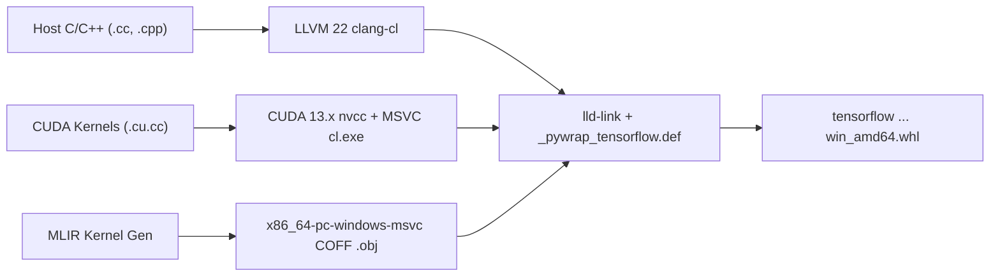

# tensorflow-windows-gpu

> **Unofficial native Windows GPU builds of TensorFlow (CUDA) — official native Windows GPU support ended after TensorFlow 2.10.**

[](#compatibility-matrix)
[](#compatibility-matrix)
[](#compatibility-matrix)
[](#architecture-hybrid-clang-cl--nvcc)
[](LICENSE)

## Why This Repo Exists

Upstream TensorFlow dropped native Windows GPU support after **v2.10**, leaving Windows developers either stuck on a 2022 release or forced into **WSL2** (with its filesystem overhead, memory limits, and friction with native Windows apps, DirectX/GUI pipelines, and IDEs).

This fork restores **full native Windows x86_64 CUDA GPU support** on top of modern **TensorFlow 2.22 (`v2.22.0-rc1`)** — including live GPU device registration, Eager & `tf.function` ops, **cuDNN 9**, **XLA GPU JIT (`jit_compile=True`)**, and **Keras 3** — using a lean, maintainable **hybrid LLVM 22 `clang-cl`/`lld-link` + `nvcc` (MSVC)** toolchain.

---

## Verified Native Windows GPU Execution

Running directly on **Windows 11 x64 (no WSL2)** from a clean Python 3.13 virtual environment:

```text
OS: Windows-11-10.0.26300-SP0
Python: 3.13.15
TensorFlow: 2.22.0-dev0+selfbuilt
Built with CUDA: True
GPUs: [PhysicalDevice(name='/physical_device:GPU:0', device_type='GPU')]
GPU details: {'device_name': 'NVIDIA GeForce RTX 5090', 'compute_capability': (12, 0)}
MatMul: /job:localhost/replica:0/task:0/device:GPU:0 (2048, 2048)
XLA JIT: /job:localhost/replica:0/task:0/device:GPU:0 (512, 512)
Training step 3 loss on /job:localhost/replica:0/task:0/device:GPU:0: 58.6182
```

**8192 × 8192 MatMul throughput (RTX 5090, CUDA 13.5, cuDNN 9.28.1, native Windows 11):**

| Precision | Mean Latency | Measured Throughput |
| :--- | ---: | ---: |
| `float32` | `9.56 ms` | **114.99 TFLOPS** |
| `float16` | `4.90 ms` | **224.19 TFLOPS** |
| `bfloat16` | `4.90 ms` | **224.29 TFLOPS** |

---

## Compatibility Matrix

| Component | Verified Reference | Expected to Work |
| :--- | :--- | :--- |
| **OS** | Windows 11 x86_64 (Developer Mode + Long Paths ON) | Windows 10 / 11 x86_64 |
| **TensorFlow** | `v2.22.0-rc1` (branch `r2.22-win-cuda`) | `r2.22-win-cuda` |
| **CUDA Toolkit** | `13.5.0` (`nvcc 13.5.37`, CCCL 3.x, PTX 9.5) | CUDA `13.x` (see [Known Limitations](#known-limitations)) |
| **cuDNN** | `9.28.1` (`cuda13`) | cuDNN `9.x` (CUDA 13 archives & standard NVIDIA installer layouts) |
| **GPU** | NVIDIA GeForce RTX 5090 (Blackwell, `compute_120`) | Any CUDA 13-supported NVIDIA GPU (`sm_80`, `sm_86`, `sm_89`, `sm_90`, `sm_120`) |
| **CPU** | AMD Ryzen 9 9950X (Zen 5) | Any x86_64 CPU (AMD or Intel; pass `/clang:-march=...` or omit for generic x86_64) |
| **Host Compiler / Linker** | LLVM `22.1.4` (`clang-cl`, `lld-link`, `llvm-lib`) | LLVM `22.x` recommended |
| **CUDA `-ccbin` Host** | VS 2022 Build Tools `17.14` (`MSVC 14.44`, Win11 SDK `10.0.26100`) | VS 2022 Build Tools (MSVC v143 + Win10/11 SDK) |
| **Python / Bazel** | CPython `3.13.15`, Bazel `7.7.0` (via Bazelisk) | CPython `3.10`–`3.13` (`HERMETIC_PYTHON_VERSION`) |

### Feature Parity (Single-GPU Focus)

| Capability | Status | Notes |
| :--- | :---: | :--- |
| Eager & `tf.function` GPU ops (`FP32` / `FP16` / `BF16`) | Supported | cuBLAS / cuBLASLt / cuFFT / cuSOLVER / cuSPARSE |
| cuDNN 9 convolutions, fused attention, backprop | Supported | Dynamically loaded via `cudnn64_<major>.dll` |
| XLA GPU JIT (`@tf.function(jit_compile=True)`) | Supported | Auto-discovers `ptxas.exe` & `libdevice.10.bc` via `CUDA_PATH` |
| Keras 3 training & inference on `/GPU:0` | Supported | Verified end-to-end on `/GPU:0` |
| NCCL / NVSHMEM multi-GPU collectives | Not available | Linux-only NVIDIA libraries (`--config=nonccl`) |
| CUDA POSIX FD VMM / GPUDirect RDMA | Not available | Linux kernel APIs; cleanly disabled on `_WIN32` |

---

## Architecture: Hybrid `clang-cl` + `nvcc`



Why hybrid `clang-cl` instead of a pure-MSVC port?

- **Minimal patch surface (~47 files vs. 190+):** Compiling host C++ with `clang-cl` avoids dozens of MSVC C++17 conformance workarounds across LLVM/MLIR, XLA, Riegeli, Protobuf, and XNNPACK while keeping full optimization on hot kernel libraries (`cwise_op`, `fused_batch_norm_op`).
- **Modern `USE_PYWRAP_RULES=True`:** Preserves upstream TensorFlow's modern pywrap architecture and `/MD` CRT linkage without checking in multi-thousand-line `.def` files.
- **Root-cause CUDA/CCCL 3.x fixes:** Fixes the `cuDoubleComplex` 16-byte alignment ICE in 6 lines (preserving parallel CUB/warp reductions), preserves full SFINAE in RAFT `mdspan`, and adds a type-erased CCCL 3.x `compat_async_resource_ref` bridge for RMM.
- **Real Windows runtime GPU discovery:** Fixes `dso_loader.cc` (`64_` DLL naming + mixed CUDA 13/12 majors), `load_library.cc` (`LOAD_LIBRARY_SEARCH_DEFAULT_DIRS`), `cuda_root_path.cc` (`CUDA_PATH`), `cudnn_api_wrappers.cc` (`GetProcAddress`), and `pywrap_tensorflow.py` (`os.add_dll_directory` + `PATH`).

---

## Quickstart

> [!NOTE]
> **Prebuilt wheels:** Portable multi-GPU `.whl` releases are not yet published on this repo — currently you build from source using the steps below. (Check the [Releases](https://github.com/debsuvra/tensorflow-windows-gpu/releases) tab for future portable wheel drops.)

### 1. Prerequisites

1. **Windows 10/11 x64** with **Developer Mode ON** (*Settings → System → For developers*, required for Bazel symlinks) and **Win32 Long Paths enabled**:
   ```powershell
   # Run once in an elevated PowerShell
   Set-ItemProperty -Path "HKLM:\SYSTEM\CurrentControlSet\Control\FileSystem" -Name "LongPathsEnabled" -Value 1
   git config --global core.longpaths true
   ```
2. **Visual Studio 2022 Build Tools** (*Desktop development with C++*, MSVC v143 + Windows 10/11 SDK).
3. **Git for Windows** (provides `bash.exe` for Bazel genrules) and **Bazelisk** (`bazel.exe`).
4. **CUDA 13.x**, **cuDNN 9.x (CUDA 13)**, **LLVM 22 (`clang-cl`, `lld-link`)**, and **Python 3.13** (an automated portable setup script is provided in [WINDOWS_CUDA_BUILD.md](WINDOWS_CUDA_BUILD.md#step-2-set-up-the-portable-toolchain-ctf)).
5. **Disk & RAM:** ~100 GB free SSD space; 64 GB+ RAM recommended (32 GB works with `--jobs=4`).

### 2. Clone & Build the Wheel

```powershell
git clone --branch r2.22-win-cuda --depth 1 https://github.com/debsuvra/tensorflow-windows-gpu.git C:\repos\tensorflow
cd C:\repos\tensorflow
```

Run Bazel with the portable `--config=win_cuda_clang` profile (adjust versions, GPU arch, and `--jobs` for your hardware):

```powershell
$env:BAZEL_SH = "C:\Program Files\Git\usr\bin\bash.exe"

bazel --output_user_root=C:/b build --config=win_cuda_clang `
  --repo_env=CUDA_PATH="C:/Program Files/NVIDIA GPU Computing Toolkit/CUDA/v13.5" `
  --repo_env=CUDNN_PATH="C:/Program Files/NVIDIA/CUDNN/v9.28" `
  --repo_env=HERMETIC_CUDA_VERSION="13.5.0" `
  --repo_env=HERMETIC_CUDNN_VERSION="9.28.1" `
  --repo_env=HERMETIC_CUDA_COMPUTE_CAPABILITIES="compute_89" `
  --repo_env=HERMETIC_PYTHON_VERSION="3.13" `
  --jobs=8 `
  //tensorflow/tools/pip_package:wheel
```

*(LLVM is auto-detected from `LLVM_PATH` / `TF_LLVM_PATH` / `PATH` / `C:\Program Files\LLVM`. Use a short `--output_user_root` like `C:/b` to avoid Windows path limits. You can also save your machine-specific flags in gitignored `.bazelrc.user` — see [WINDOWS_CUDA_BUILD.md](WINDOWS_CUDA_BUILD.md) for full details, CPU `-march` options, and troubleshooting.)*

The built wheel is written to:
```text
bazel-bin\tensorflow\tools\pip_package\wheel_house\tensorflow-*.whl
```

### 3. Install & Verify GPU Execution

Install in a clean virtual environment **outside** the `tensorflow` source directory, ensuring `CUDA_PATH` and `CUDNN_PATH` point to your CUDA 13.x and cuDNN 9.x directories:

```powershell
cd C:\
python -m venv tf_gpu_env
.\tf_gpu_env\Scripts\Activate.ps1
pip install C:\repos\tensorflow\bazel-bin\tensorflow\tools\pip_package\wheel_house\tensorflow-*.whl

# Required if not already set in Windows System Environment Variables:
$env:CUDA_PATH  = "C:\Program Files\NVIDIA GPU Computing Toolkit\CUDA\v13.5"
$env:CUDNN_PATH = "C:\Program Files\NVIDIA\CUDNN\v9.28"
```

Verify GPU detection, cuDNN, XLA JIT, and training:

```python
import tensorflow as tf

print("TensorFlow:", tf.__version__, "| Built with CUDA:", tf.test.is_built_with_cuda())
gpus = tf.config.list_physical_devices("GPU")
print("GPUs:", gpus)
assert gpus, "No GPU detected — verify CUDA_PATH and CUDNN_PATH!"

with tf.device("/GPU:0"):
    x = tf.random.normal((2048, 2048))
    y = tf.matmul(x, x)
    print("Eager MatMul:", y.device, y.shape)

    @tf.function(jit_compile=True)
    def xla_step(a, b):
        return tf.nn.gelu(tf.matmul(a, b))

    z = xla_step(tf.random.normal((512, 512)), tf.random.normal((512, 512)))
    print("XLA JIT:", z.device, z.shape)

    w = tf.Variable(tf.random.normal((64, 10)))
    opt = tf.optimizers.Adam(1e-2)
    xs, ys = tf.random.normal((256, 64)), tf.random.normal((256, 10))
    for _ in range(3):
        with tf.GradientTape() as tape:
            loss = tf.reduce_mean(tf.square(tf.matmul(xs, w) - ys))
        opt.apply_gradients(zip(tape.gradient(loss, [w]), [w]))
    print(f"Training step 3 loss on {loss.device}: {float(loss):.4f}")
```

For the full end-to-end walkthrough — including an automated portable toolchain downloader (`setup_toolchain.ps1`), CPU/GPU/RAM flag tables, `.bazelrc.user` setup, benchmark scripts, and a technical breakdown of every patch — see **[WINDOWS_CUDA_BUILD.md](WINDOWS_CUDA_BUILD.md)**.

---

## Known Limitations

- **CUDA 13.x required:** The RMM patch bridges CUDA 13's CCCL 3.x `cuda::mr` APIs and will not build cleanly against CUDA 12.x (CCCL 2.x).
- **LLVM 22 recommended:** `_pywrap_tensorflow.def` includes a COFF weak-external export alias tuned for LLVM 22 + Abseil `lts_20260526`; older LLVM major versions (19–21) are untested.
- **No NCCL / multi-GPU collectives:** Built with `--config=nonccl` (NVIDIA does not ship native Windows NCCL). Single-GPU and host-coordinated setups work normally.
- **Python wheel target only:** Standalone `tensorflow_cc.dll` / C++ SDK packaging is not currently configured.
- **Runtime DLL env vars:** TensorFlow discovers CUDA/cuDNN via `TF_CUDA_DLL_DIRECTORIES`, `CUDA_PATH` / `LOCAL_CUDA_PATH`, and `CUDNN_PATH` / `LOCAL_CUDNN_PATH`. Because NVIDIA's cuDNN archive does not always register `CUDNN_PATH`, set it in your environment if cuDNN DLLs aren't on `PATH`.
- **Linker flag:** `win_cuda_clang` passes `--linkopt=/FORCE:MULTIPLE` to reconcile benign COMDAT duplicates across the `clang-cl` / `nvcc(cl.exe)` object boundary.
- **`configure.py`:** Bypass `configure.py` and invoke Bazel directly with `--config=win_cuda_clang`.

---

## Reporting Issues

When opening an issue on [GitHub Issues](https://github.com/debsuvra/tensorflow-windows-gpu/issues), please include:

1. **Hardware & OS:** Windows version (`winver`), CPU model, GPU model, and `nvidia-smi` output.
2. **Toolchain versions:** CUDA, cuDNN, LLVM (`clang-cl --version`), VS Build Tools / MSVC version, Python version, and Bazel version.
3. **Exact command & log:** Your full `bazel` invocation (or runtime env vars `CUDA_PATH` / `CUDNN_PATH`) plus the complete error message / traceback.

---

## Upstream Attribution & License

This repository is an unofficial fork of [tensorflow/tensorflow](https://github.com/tensorflow/tensorflow) based on tag `v2.22.0-rc1` (`d1977008`) and is distributed under the same **[Apache License 2.0](LICENSE)**. All TensorFlow trademarks and upstream code belong to their respective authors.
