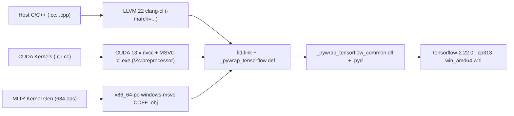

# Building TensorFlow `v2.22.0-rc1` Natively on Windows 11 with CUDA 13.x, cuDNN 9.x, and Hybrid `clang-cl` + `nvcc`

Official TensorFlow pip wheels dropped native Windows GPU support after TensorFlow 2.10, directing Windows users to WSL2. However, native Windows CUDA execution remains completely achievable — including **CUDA 13.5**, **cuDNN 9**, **XLA GPU JIT**, **Keras 3**, **Python 3.13**, **Blackwell (`sm_120`)**, and **LLVM 22 `clang-cl`** host optimization — with a lean patchset and a clean build environment.

This guide walks through reproducing a full native Windows TensorFlow GPU build from source, explains how to customize CPU/GPU/RAM flags for your own machine via `.bazelrc.user`, and documents every Windows, CUDA 13.x (CCCL 3.x), and LLVM 22 issue resolved along the way.

---

## Tested Reference Configuration

| Component | Verified Version / Hardware |
| :--- | :--- |
| **OS** | Windows 11 x86_64 (Developer Mode ON, Long Paths enabled) |
| **CPU / RAM** | AMD Ryzen 9 9950X (Zen 5, 16C/32T, AVX-512), 128 GB DDR5 |
| **GPU / Driver** | NVIDIA GeForce RTX 5090 (32 GB, Blackwell `sm_120a`), Driver `621.14` (CUDA `13.5`) |
| **TensorFlow** | `v2.22.0-rc1` (base commit `d1977008f5d725c30d0d1f5073579b55a87f1d52`) |
| **CUDA Toolkit** | `13.5.0` (`nvcc V13.5.37`, CCCL `3.x`, PTX `9.5`) |
| **cuDNN** | `9.28.1.4` (CUDA 13 archive) |
| **Host Compiler / Linker** | LLVM `22.1.4` (`clang-cl`, `lld-link`, `llvm-lib`) |
| **CUDA Host Compiler (`-ccbin`)** | Visual Studio 2022 Build Tools `17.14.45` (`MSVC 14.44.35207`, Windows SDK `10.0.26100.0`) |
| **Build System / Python** | Bazel `7.7.0` (via Bazelisk `v1.30.0`), CPython `3.13.15` (`cp313-win_amd64`) |

### Windows vs. Linux Feature Parity (Single-GPU Focus)

| Capability | Native Windows Build | Notes |
| :--- | :---: | :--- |
| Eager & `tf.function` GPU ops (`FP32` / `FP16` / `BF16`) | Full parity | Native cuBLAS / cuBLASLt / cuFFT / cuSOLVER / cuSPARSE |
| cuDNN 9 convolutions, fused attention, backprop | Full parity | Dynamically loaded via `cudnn64_<major>.dll` |
| XLA GPU JIT (`@tf.function(jit_compile=True)`) | Full parity | Uses `ptxas.exe` + `nvvm/libdevice/libdevice.10.bc` |
| Keras 3 training & inference on `/GPU:0` | Full parity | Verified with Keras `3.16` |
| NCCL / NVSHMEM multi-GPU collectives | Not available | Linux-only NVIDIA libraries (`--config=nonccl`); irrelevant for single-GPU |
| CUDA POSIX FD VMM / GPUDirect RDMA | Not available | Linux kernel APIs; disabled cleanly on `_WIN32` |

---

## Hybrid Compiler Architecture

NVIDIA's `nvcc` on Windows requires MSVC `cl.exe` as its host preprocessor/compiler (`-ccbin`), whereas compiling all of TensorFlow/XLA/Eigen/LLVM host C++ with LLVM `clang-cl` + `lld-link` yields dramatically faster link times, cleaner modern C++ optimization (`-march=...`), and eliminates dozens of MSVC conformance & ICE workarounds.



---

## Toolchain Paths: Standard Installs vs. Portable Root (`C:\tf`)

You can build either against **standard Windows installations** (`C:\Program Files\NVIDIA GPU Computing Toolkit\CUDA\v13.x`, `C:\Program Files\NVIDIA\CUDNN\v9.x`, `C:\Program Files\LLVM`) or against a **portable space-free root** like `C:\tf`.

- **Auto-discovery:** `--config=win_cuda_clang` automatically falls back `LOCAL_CUDA_PATH` → `CUDA_PATH` / `CUDA_TOOLKIT_PATH`, `LOCAL_CUDNN_PATH` → `CUDNN_PATH`, matches stock NVIDIA cuDNN 9.x versioned directories (e.g. `bin/13.0/x64` under CUDA `13.5.0`), auto-detects LLVM from `TF_LLVM_PATH` / `LLVM_PATH` / `BAZEL_LLVM` / `PATH` / `C:\Program Files\LLVM`, quotes paths with spaces for `nvcc`, and skips the Windows 11 Store `WindowsApps\python.exe` alias stub.
- **Short Bazel output root still required:** Regardless of where CUDA/cuDNN/LLVM live, always pass a short `--output_user_root` (e.g. `C:/b` or `C:/tf/bazel_root`) so deep Bazel external paths stay well under Windows limits.
- **Why many builders prefer a portable `C:\tf` root:** It pins exact redist versions without altering global system `PATH`, and keeps Bazel cache/temp/downloads neatly isolated.

---

## Step 1: System Prerequisites

1. **Windows 10/11 x64 with Developer Mode & Long Paths enabled:**
   - Enable **Settings → System → For developers → Developer Mode** (allows Bazel symlinks without elevated Administrator prompts).
   - Enable Win32 long paths (run in an elevated PowerShell, then reboot if newly changed):
     ```powershell
     Set-ItemProperty -Path "HKLM:\SYSTEM\CurrentControlSet\Control\FileSystem" -Name "LongPathsEnabled" -Value 1
     git config --global core.longpaths true
     ```
2. **Visual Studio 2022 Build Tools (`17.14.x`):**
   - Install **Desktop development with C++** including **MSVC v143 - VS 2022 C++ x64/x86 build tools** and **Windows 10/11 SDK**.
   - Required for the MSVC STL/CRT headers, Windows SDK libraries, and `nvcc`'s `-ccbin` host compiler.
3. **Git for Windows:**
   - Standard install providing `C:\Program Files\Git\usr\bin\bash.exe` (required by Bazel genrules).
4. **NVIDIA GPU Driver:**
   - Must support the CUDA Toolkit version you build against (for CUDA `13.5`, verify `nvidia-smi` reports CUDA Version `13.5` or newer).
5. **`uv` (recommended) or CPython `3.13.x`:**
   - Install `uv` via `winget install astral-sh.uv` (used below to provision a clean CPython `3.13` venv).
6. **Hardware headroom:**
   - **Disk:** ~100 GB free on an NVMe SSD (Bazel output cache + source repo + toolchain).
   - **RAM:** 64–128 GB recommended; 32 GB works if you lower `--jobs` (see [Step 4](#step-4-customize-flags-for-your-hardware)).

---

## Step 2: Set Up the Portable Toolchain (`C:\tf`)

*(Skip the CUDA/cuDNN/LLVM downloads below if you already have CUDA 13.x, cuDNN 9.x, and LLVM 22 installed in standard Windows directories — just pass `CUDA_PATH` / `CUDNN_PATH` in Step 4.)*

Save and run the following PowerShell script (`setup_toolchain.ps1`). It downloads and SHA256-verifies Bazelisk `v1.30.0`, the 23 required NVIDIA CUDA `13.5.0` `windows-x86_64` redist archives, cuDNN `9.28.1` (`cuda13`), LLVM `22.1.4`, and builds a Python `3.13` venv with all build dependencies.

```powershell
# setup_toolchain.ps1
$ErrorActionPreference = "Stop"

$Root      = "C:\tf"
$Downloads = "$Root\downloads"
$BinDir    = "$Root\bin"
$CudaDir   = "$Root\cuda"
$CudnnDir  = "$Root\cudnn"
$LlvmDir   = "$Root\llvm"
$TmpDir    = "$Root\tmp"
$BazelRoot = "$Root\bazel_root"

foreach ($d in @($Root, $Downloads, $BinDir, $CudaDir, $CudnnDir, $LlvmDir, $TmpDir, $BazelRoot)) {
    New-Item -ItemType Directory -Force -Path $d | Out-Null
}

function Download-File {
    param([string]$Url, [string]$OutFile, [string]$ExpectedSha256 = "")
    if (Test-Path $OutFile) {
        if ($ExpectedSha256 -ne "") {
            $h = (Get-FileHash -Path $OutFile -Algorithm SHA256).Hash.ToLower()
            if ($h -eq $ExpectedSha256.ToLower()) {
                Write-Host "[SKIP] Verified: $(Split-Path -Leaf $OutFile)"
                return
            }
        } else {
            Write-Host "[SKIP] Exists: $(Split-Path -Leaf $OutFile)"
            return
        }
    }
    Write-Host "[DL] $Url"
    & curl.exe -fL --retry 3 --retry-delay 2 -sS -o $OutFile $Url
    if ($LASTEXITCODE -ne 0) { throw "Failed to download $Url" }
    if ($ExpectedSha256 -ne "") {
        $h = (Get-FileHash -Path $OutFile -Algorithm SHA256).Hash.ToLower()
        if ($h -ne $ExpectedSha256.ToLower()) {
            Remove-Item -Force $OutFile
            throw "SHA256 mismatch for $OutFile : got $h expected $ExpectedSha256"
        }
    }
}

function Extract-ZipStripTop {
    param([string]$ZipPath, [string]$DestDir)
    $stage = Join-Path $TmpDir ("extract_" + [System.IO.Path]::GetRandomFileName())
    New-Item -ItemType Directory -Force -Path $stage | Out-Null
    try {
        & tar.exe -xf $ZipPath -C $stage
        if ($LASTEXITCODE -ne 0) { throw "tar failed on $ZipPath" }
        $items = Get-ChildItem -Path $stage
        $src = if ($items.Count -eq 1 -and $items[0].PSIsContainer) { $items[0].FullName } else { $stage }
        & robocopy $src $DestDir /E /NFL /NDL /NJH /NJS /NC /NS /NP | Out-Null
        if ($LASTEXITCODE -ge 8) { throw "robocopy failed ($LASTEXITCODE)" }
    } finally {
        Remove-Item -Recurse -Force $stage -ErrorAction SilentlyContinue
    }
}

# 1. Bazelisk v1.30.0 (automatically fetches Bazel 7.7.0 per TF's .bazelversion)
Write-Host "=== 1. Bazelisk ==="
Download-File "https://github.com/bazelbuild/bazelisk/releases/download/v1.30.0/bazelisk-windows-amd64.exe" "$BinDir\bazel.exe"

# 2. CUDA 13.5.0 redist archives (23 components)
Write-Host "=== 2. CUDA 13.5.0 ==="
$cudaBase = "https://developer.download.nvidia.com/compute/cuda/redist/"
$cudaManifest = Invoke-RestMethod "${cudaBase}redistrib_13.5.0.json"
$cudaComponents = @(
    "cccl", "cuda_crt", "cuda_cudart", "cuda_cuobjdump", "cuda_cupti",
    "cuda_cuxxfilt", "cuda_nvcc", "cuda_nvdisasm", "cuda_nvml_dev",
    "cuda_nvprune", "cuda_nvrtc", "cuda_nvtx", "cuda_profiler_api",
    "cuda_tileiras", "libcublas", "libcufft", "libcurand",
    "libcusolver", "libcusparse", "libnvfatbin", "libnvjitlink",
    "libnvptxcompiler", "libnvvm"
)
$cudaMarker = Join-Path $CudaDir ".cuda_13.5.0_ready"
if (-not (Test-Path $cudaMarker)) {
    foreach ($comp in $cudaComponents) {
        $entry = $cudaManifest.$comp.'windows-x86_64'
        if (-not $entry) { continue }
        $file = Join-Path $Downloads (Split-Path -Leaf $entry.relative_path)
        Download-File ($cudaBase + $entry.relative_path) $file $entry.sha256
        Write-Host "[EXTRACT] $comp"
        Extract-ZipStripTop $file $CudaDir
    }
    "13.5.0" | Set-Content $cudaMarker
}

# 3. cuDNN 9.28.1 (CUDA 13)
Write-Host "=== 3. cuDNN 9.28.1 ==="
$cudnnMarker = Join-Path $CudnnDir ".cudnn_9.28.1_ready"
if (-not (Test-Path $cudnnMarker)) {
    $cudnnBase = "https://developer.download.nvidia.com/compute/cudnn/redist/"
    $cudnnManifest = Invoke-RestMethod "${cudnnBase}redistrib_9.28.1.json"
    $entry = $cudnnManifest.cudnn.'windows-x86_64'.cuda13
    $file = Join-Path $Downloads (Split-Path -Leaf $entry.relative_path)
    Download-File ($cudnnBase + $entry.relative_path) $file $entry.sha256
    Write-Host "[EXTRACT] cuDNN 9.28.1"
    Extract-ZipStripTop $file $CudnnDir
    "9.28.1" | Set-Content $cudnnMarker
}

# 4. LLVM 22.1.4 (portable Windows x86_64)
Write-Host "=== 4. LLVM 22.1.4 ==="
$llvmMarker = Join-Path $LlvmDir ".llvm_22.1.4_ready"
if (-not (Test-Path $llvmMarker)) {
    $llvmFile = Join-Path $Downloads "clang+llvm-22.1.4-x86_64-pc-windows-msvc.tar.xz"
    Download-File "https://github.com/llvm/llvm-project/releases/download/llvmorg-22.1.4/clang+llvm-22.1.4-x86_64-pc-windows-msvc.tar.xz" $llvmFile
    Write-Host "[EXTRACT] LLVM 22.1.4"
    & tar.exe -xf $llvmFile -C $LlvmDir --strip-components=1
    if ($LASTEXITCODE -ne 0) { throw "Failed to extract LLVM 22.1.4" }
    "22.1.4" | Set-Content $llvmMarker
}

# 5. Python 3.13 build venv (+ python3.exe shim for Git Bash genrules)
Write-Host "=== 5. Python 3.13 Build Venv ==="
$VenvDir = "$Root\venv313"
if (-not (Test-Path "$VenvDir\Scripts\python.exe")) {
    & uv venv --python 3.13.15 $VenvDir --seed
}
& uv pip install --python "$VenvDir\Scripts\python.exe" `
    numpy packaging wheel setuptools requests opt_einsum ml_dtypes

# Prevent Git Bash genrules invoking `python3` from hitting the Microsoft Store alias stub.
Copy-Item -Force "$VenvDir\Scripts\python.exe" "$VenvDir\Scripts\python3.exe"

Write-Host "=== TOOLCHAIN READY ==="
```

---

## Step 3: Clone the Repository

```powershell
git clone --branch r2.22-win-cuda --depth 1 https://github.com/debsuvra/tensorflow-windows-gpu.git C:\repos\tensorflow
cd C:\repos\tensorflow
```

---

## Step 4: Customize Flags for Your Hardware (`.bazelrc.user`)

Tracked `.bazelrc` provides the portable base profile `--config=win_cuda_clang`. Create a gitignored `.bazelrc.user` in the repo root (`.bazelrc` automatically `try-import`s it) with your hardware profile:

```bazelrc
# .bazelrc.user (gitignored)
common:my_win_gpu --config=win_cuda_clang
common:my_win_gpu --repo_env=HERMETIC_CUDA_VERSION="13.5.0"
common:my_win_gpu --repo_env=HERMETIC_CUDNN_VERSION="9.28.1"
common:my_win_gpu --repo_env=HERMETIC_CUDA_COMPUTE_CAPABILITIES="compute_120"
common:my_win_gpu --repo_env=HERMETIC_PYTHON_VERSION="3.13"

# Optional if CUDA_PATH / CUDNN_PATH / LLVM_PATH aren't set globally:
common:my_win_gpu --repo_env=LOCAL_CUDA_PATH="C:/tf/cuda"
common:my_win_gpu --repo_env=LOCAL_CUDNN_PATH="C:/tf/cudnn"
common:my_win_gpu --repo_env=LLVM_PATH="C:/tf/llvm"

# Optional CPU tuning (omit for portable x86-64 wheels):
common:my_win_gpu --copt=/clang:-march=native
common:my_win_gpu --host_copt=/clang:-march=native

# Adjust for your RAM (see table below):
common:my_win_gpu --jobs=8
common:my_win_gpu --local_resources=memory=HOST_RAM*.65
```

### 1. CPU Target (`--copt` / `--host_copt`)

| Your CPU | `.bazelrc.user` Flag | Notes |
| :--- | :--- | :--- |
| AMD Zen 5 (Ryzen 9000) | `/clang:-march=znver5` | Tested reference; AVX-512 + AVX-VNNI |
| AMD Zen 4 (Ryzen 7000) | `/clang:-march=znver4` | AVX-512 |
| AMD Zen 3 (Ryzen 5000) | `/clang:-march=znver3` | AVX2 |
| Intel 12th–14th Gen / Core Ultra | `/clang:-march=alderlake` or `arrowlake` | AVX2 + AVX-VNNI |
| Any modern CPU (portable wheel) | `/clang:-march=x86-64-v3` (or omit) | AVX2 + FMA; shareable across modern x64 PCs |
| Auto-detect host CPU | `/clang:-march=native` | Optimizes strictly for the build machine |

> [!WARNING]
> **Do not remove** the three XNNPACK AVX-512 flags in `win_cuda_clang` if building with LLVM 22 `clang-cl` on an AVX-512 CPU (`znver4`/`znver5`/`skylake-avx512`+):
> ```text
> --define=xnn_enable_avx512vnnigfni=false
> --define=xnn_enable_avx512vnni=false
> --define=xnn_enable_avx512skx=false
> ```
> See [Technical Deep-Dive #1](#1-xnnpack-7x16c8-avx-512-win64-abi--llvm-22-ram-explosion) for why these prevent 30–40 GB/process OOM crashes.

### 2. GPU Compute Capabilities (`HERMETIC_CUDA_COMPUTE_CAPABILITIES`)

Use `compute_XX` to embed **both** native `sm_XX` SASS machine code (zero JIT startup delay) **and** forward-compatible PTX, or `sm_XX` for SASS only.

| NVIDIA GPU Generation | Flag Value |
| :--- | :--- |
| RTX 50-series (Blackwell, e.g. RTX 5090 / 5080) | `compute_120` |
| RTX 40-series (Ada Lovelace, e.g. RTX 4090 / 4080) | `compute_89` |
| RTX 30-series (Ampere, e.g. RTX 3090 / 3080) | `compute_86` |
| Multi-architecture shareable wheel | `sm_80,sm_86,sm_89,sm_90,compute_120` |

Targeting a single architecture cuts CUDA `nvcc` compile time and final wheel size significantly.

### 3. RAM & Build Concurrency (`--jobs` / `--local_resources`)

| System RAM | Recommended Values | Notes |
| :--- | :--- | :--- |
| **128 GB** | `--jobs=12 --local_resources=memory=HOST_RAM*.6` | Peak ~35–55 GB; leaves system responsive |
| **64 GB** | `--jobs=8 --local_resources=memory=HOST_RAM*.65` | Peak ~25–40 GB; avoids heavy paging |
| **32 GB** | `--jobs=4 --local_resources=memory=HOST_RAM*.7` | Slower, but prevents OOM during Eigen/XLA templates |

---

## Step 5: Build the TensorFlow Wheel

Create a wrapper script `run_bazel.ps1` so every Bazel invocation gets an identical environment (preventing accidental cache invalidations across runs):

```powershell
# run_bazel.ps1
param(
    [Parameter(ValueFromRemainingArguments=$true)]
    [string[]]$BazelArgs
)
$ErrorActionPreference = "Stop"

$env:BAZEL_SH        = "C:\Program Files\Git\usr\bin\bash.exe"
$env:PYTHON_BIN_PATH = "C:\tf\venv313\Scripts\python.exe"
$env:TEMP            = "C:\tf\tmp"
$env:TMP             = "C:\tf\tmp"
$env:TMPDIR          = "C:\tf\tmp"
$env:PATH            = "C:\tf\bin;C:\tf\venv313\Scripts;C:\Program Files\Git\usr\bin;$env:PATH"

Set-Location "C:\repos\tensorflow"
& "C:\tf\bin\bazel.exe" --output_user_root="C:/tf/bazel_root" @BazelArgs
exit $LASTEXITCODE
```

Start the wheel build:

```powershell
.\run_bazel.ps1 build --config=my_win_gpu //tensorflow/tools/pip_package:wheel
```

### What to Expect During the Build

- **Scale:** ~`63,000` Bazel actions total (on a 16-core Zen 5 with `--jobs=12`, expect ~1.5–2.5 hours end-to-end).
- **Resuming safely:** If you cancel a build (`Ctrl+C`), **nothing already compiled is lost** — Bazel persists every completed action in `--output_user_root` and resumes cleanly on the next run as long as your flags and environment variables stay identical.
- **The 99% "stall" (normal!):** Near the end of compilation, CPU usage will drop to **~3–6%** for 20–35 minutes while Bazel waits on two massive single-threaded Eigen template files:
  - `tensorflow/core/kernels/cwise_op_div.cc` (~20 min, ~4 GB RAM)
  - `tensorflow/core/kernels/cwise_op_select.cc` (~35 min, ~4 GB RAM)

  **Do not cancel the build** when you see these — `clang-cl` is actively optimizing thousands of Eigen functor instantiations.
- **Final link:** `lld-link` produces `_pywrap_tensorflow_common.dll` (~`1.4 GB`) plus Python `.pyd` extensions and packages the wheel into:
  ```text
  bazel-bin\tensorflow\tools\pip_package\wheel_house\tensorflow-2.22.0.dev0+selfbuilt-cp313-cp313-win_amd64.whl
  ```

---

## Step 6: Install & Verify Live GPU Execution

### Runtime CUDA / cuDNN Discovery

When `import tensorflow` executes on Windows, `tensorflow/python/pywrap_tensorflow.py` registers DLL search directories (via both `os.add_dll_directory()` for Python 3.8+ and `PATH` for NVIDIA's internal `LoadLibrary` calls) in this order:

1. `TF_CUDA_DLL_DIRECTORIES` (explicit `;`-separated override, if set)
2. `LOCAL_CUDA_PATH`, `CUDA_PATH`, `CUDA_TOOLKIT_PATH` (`bin\x64`, `bin`, `lib\x64`, `extras\CUPTI\lib64`)
3. `LOCAL_CUDNN_PATH`, `CUDNN_PATH` (`bin\x64`, `bin\*\x64`, `bin`, `lib\x64`)

Likewise, XLA JIT (`cuda_root_path.cc`) locates `ptxas.exe` and `nvvm\libdevice\libdevice.10.bc` via `CUDA_HOME`, `CUDA_PATH`, and `LOCAL_CUDA_PATH`.

### Clean Venv Installation

Always test **outside** the TensorFlow source repository (otherwise Python imports the local `tensorflow/` source tree instead of the installed wheel):

```powershell
cd C:\tf
uv venv --python 3.13.15 C:\tf\test_venv313 --seed
uv pip install --python C:\tf\test_venv313\Scripts\python.exe --no-cache `
    C:\repos\tensorflow\bazel-bin\tensorflow\tools\pip_package\wheel_house\tensorflow-*.whl

$env:CUDA_PATH  = "C:\tf\cuda"
$env:CUDNN_PATH = "C:\tf\cudnn"
```

### Verification & Benchmark Script (`verify_gpu.py`)

```python
import sys, time
import numpy as np
import tensorflow as tf
import keras

print("Python:", sys.version)
print("TF version:", tf.__version__)
print("Built with CUDA:", tf.test.is_built_with_cuda())
print("Build info:", dict(tf.sysconfig.get_build_info()))

gpus = tf.config.list_physical_devices("GPU")
print("GPUs:", gpus)
assert tf.test.is_built_with_cuda() and len(gpus) >= 1
for g in gpus:
    print("Details:", tf.config.experimental.get_device_details(g))
    tf.config.experimental.set_memory_growth(g, True)

# 1. Eager MatMul (FP32, FP16, BF16)
for dtype in (tf.float32, tf.float16, tf.bfloat16):
    with tf.device("/GPU:0"):
        a = tf.random.normal([1024, 1024], dtype=dtype)
        b = tf.random.normal([1024, 1024], dtype=dtype)
        c = tf.matmul(a, b)
        s = float(tf.reduce_sum(tf.cast(c, tf.float32)).numpy())
    assert "GPU:0" in c.device and np.isfinite(s)
print("[PASS] Eager GPU MatMul (FP32/FP16/BF16)")

# 2. cuDNN Conv2D + Backprop
with tf.device("/GPU:0"):
    x = tf.random.normal([8, 64, 64, 32])
    w = tf.Variable(tf.random.normal([3, 3, 32, 64], stddev=0.05))
    with tf.GradientTape() as tape:
        y = tf.nn.relu(tf.nn.conv2d(x, w, strides=1, padding="SAME"))
        loss = tf.reduce_mean(tf.square(y))
    grad_norm = float(tf.linalg.norm(tape.gradient(loss, w)).numpy())
assert "GPU:0" in y.device and np.isfinite(grad_norm) and grad_norm > 0
print(f"[PASS] cuDNN Conv2D + GradientTape (grad_norm={grad_norm:.6f})")

# 3. XLA GPU JIT
@tf.function(jit_compile=True)
def xla_block(x, w1, w2):
    return tf.matmul(tf.nn.softmax(tf.nn.gelu(tf.matmul(x, w1)), axis=-1), w2)

with tf.device("/GPU:0"):
    x_in = tf.random.normal([256, 512])
    w1 = tf.random.normal([512, 1024], stddev=0.05)
    w2 = tf.random.normal([1024, 512], stddev=0.05)
    out_xla = xla_block(x_in, w1, w2)
    out_eager = tf.matmul(tf.nn.softmax(tf.nn.gelu(tf.matmul(x_in, w1)), axis=-1), w2)
    max_diff = float(tf.reduce_max(tf.abs(out_xla - out_eager)).numpy())
assert "GPU:0" in out_xla.device and max_diff < 1e-4
print(f"[PASS] XLA GPU JIT (max_diff={max_diff:.2e})")

# 4. Keras 3 Training Step
with tf.device("/GPU:0"):
    model = keras.Sequential([
        keras.layers.Input(shape=(32, 32, 3)),
        keras.layers.Conv2D(32, 3, padding="same", activation="relu"),
        keras.layers.GlobalAveragePooling2D(),
        keras.layers.Dense(10),
    ])
    model.compile(
        optimizer=keras.optimizers.Adam(1e-3),
        loss=keras.losses.SparseCategoricalCrossentropy(from_logits=True),
    )
    hist = model.fit(
        tf.random.normal([64, 32, 32, 3]),
        tf.random.uniform([64], maxval=10, dtype=tf.int32),
        epochs=2, batch_size=32, verbose=0,
    )
print("[PASS] Keras 3 GPU training:", [round(v, 4) for v in hist.history["loss"]])

# 5. 8192 x 8192 MatMul Throughput Benchmark
N, iters = 8192, 20
for dtype in (tf.float32, tf.float16, tf.bfloat16):
    with tf.device("/GPU:0"):
        a = tf.random.normal([N, N], dtype=dtype)
        b = tf.random.normal([N, N], dtype=dtype)
        for _ in range(5):
            c = tf.matmul(a, b)
        _ = c[0, 0].numpy()
        t0 = time.perf_counter()
        for _ in range(iters):
            c = tf.matmul(a, b)
        _ = c[0, 0].numpy()
        dt = (time.perf_counter() - t0) / iters
    tflops = (2.0 * N * N * N) / (dt * 1e12)
    print(f"  {dtype.name:8s}: {dt*1000:6.2f} ms -> {tflops:7.2f} TFLOPS")
```

---

## Technical Deep-Dive: Every Issue Solved in This Fork

### 1. XNNPACK `7x16c8` AVX-512 Win64 ABI + LLVM 22 RAM Explosion
Four auto-generated XNNPACK `igemm` microkernels (`qs8-qc8w-igemm-7x16c8-minmax-fp32-avx512{skx,vnni,vnnigfni}`) hold **34+ simultaneous 512-bit `zmm` accumulators/values** (exceeding all 32 hardware `zmm` registers). On Linux System V ABI, all vector registers are caller-saved; on **Windows x64 ABI**, `XMM6`–`XMM15` (`10` registers) are callee-saved. Under LLVM 22 `clang-cl` with AVX-512 enabled, instruction scheduling + greedy register allocation spikes to **30–40 GB RAM per single `clang-cl` process**.

- **Fix:** `.bazelrc` sets `--define=xnn_enable_avx512vnnigfni=false --define=xnn_enable_avx512vnni=false --define=xnn_enable_avx512skx=false`. This skips only those pathological quantized CPU microkernels while retaining AVX-512F, AVX-512BF16, AVX-512VBMI, AVX256VNNI, and AVX2 — with zero impact on GPU workloads.

### 2. Hybrid `clang-cl` + `nvcc` Toolchain & Linker Fixes
- **`rules_ml_toolchain` overrides (`third_party/rules_ml_toolchain_overrides/` + `tensorflow/workspace3.bzl`):** Adds Windows local CUDA 13.x / cuDNN 9.x discovery (including `cccl`, `nvptxcompiler`, `nvfatbin`, `CUDA_PATH`/`CUDNN_PATH` fallbacks, and cuDNN same-major versioned subdirs), CUDA `13.5` → PTX `9.5` version tables, Windows NCCL/NVSHMEM no-ops, modern `/MD` CRT features (removing `/J`), and a hybrid crosstool dispatching host C++ to `clang-cl`/`lld-link`/`llvm-lib` and `.cu.cc` files to `nvcc` + MSVC `cl.exe /Zc:preprocessor` with automatic `.rsp`/`NVCC_TEMP_DIR` cleanup and space-safe quoting.
- **MLIR Generated Kernels (`tensorflow/core/kernels/mlir_generated/build_defs.bzl`):** Added `"@platforms//os:windows": "x86_64-pc-windows-msvc"` so generated GPU kernels emit Windows COFF `.obj` files instead of Linux ELF `.o`.
- **Windows Path Separator (`third_party/xla/xla/util/build_defs.bzl`):** Switched `ProtoDataCompiler` from hardcoded `:` to `ctx.configuration.host_path_separator` (`;`) with proper shell quoting.
- **Import `.lib` Routing (`third_party/xla/xla/tsl/cuda/BUILD.bazel`):** Routed CUDA/cuDNN/NVML/NVRTC through Windows import `.lib` targets via `if_cuda_libs`, and guarded `*_stub` `textual_hdrs` so CPU-only Windows builds remain intact.
- **COFF Symbol Exports (`tensorflow/python/_pywrap_tensorflow.def`):** Exported 18 missing Abseil/Protobuf symbols referenced by `.pyd` extensions plus an explicit COFF weak-external export alias for `absl::StatusBuilder::CreateStatusAndConditionallyLog`.

### 3. CUDA 13.x / CCCL 3.x Breaking Changes
- **RAPIDS `rmm` 25.08 (`third_party/xla/third_party/rmm/windows_fixes.patch`):** Implemented a null-safe, type-erased `detail::compat_async_resource_ref` bridge plus default-alignment (256-byte) and explicit-alignment `allocate_sync` / `allocate(cuda::stream_ref, ...)` forwarding overloads on `device_memory_resource`.
- **Thrust 3.x (`tensorflow/core/kernels/where_op_gpu.cu.h`, `dynamic_partition_op_gpu.cu.cc`):** Guarded the removed `thrust::detail::iterator_facade_category` behind `THRUST_VERSION < 300000` (falling back to `std::random_access_iterator_tag`), and added `#include <thrust/iterator/constant_iterator.h>`.

### 4. Windows Case-Insensitivity, LLP64, & NVCC + MSVC Quirks
- **`VERSION` vs. `<version>` Collision (`raft`, `rmm`, `rapids_logger` patches):** Deleted the root `VERSION` file in each RAPIDS repo so `-I<repo_root>` on case-insensitive NTFS doesn't shadow C++20 `<version>`.
- **LLP64 32-bit `long` Bugs:** Fixed `1024L` / `1L << 53` / `1ul` / duplicate `uint64_t` vs `unsigned long long` / 8-byte `long int` atomic specializations in `gpu_launch_config.h`, `debug_ops.h`, `reduction_gpu_kernels.cu.h`, `raft/core/mdspan.hpp`, `raft/util/vectorized.cuh`, and `raft/util/device_atomics.cuh`.
- **`nvcc` ICE on `complex128` (`tensorflow/core/kernels/reduction_gpu_kernels.cu.h`):** Replaced 16-byte aligned `cuDoubleComplex divisor` in `DividesBy<std::complex<double>>` with plain `double divisor_real, divisor_imag` (6 lines), eliminating the MSVC/nvcc structure-layout ICE while preserving 100% of TF's parallel warp/block/CUB reduction kernels.
- **RAPIDS `raft` Bundled `mdspan` (`raft/windows_fixes.patch`):** Preserved full SFINAE under `nvcc` + MSVC `/Zc:preprocessor` via `_MSVC_TRADITIONAL`, `std::conjunction_v` fold replacements, `_is_compatible_extents`, and `not` → `!` fixes (including `mdbuffer.cuh`).
- **Abseil, Highway, Triton & XLA Fixes:** Patched `absl` hash friend/visibility for `nvcc`+MSVC, disabled unsupported `HWY_AVX10_2` on LLVM 22, fixed Triton `PartitionLoops.cpp` & `Utility.cpp` for Clang 22, removed duplicate `CSRSparseMatrixBatchMulVec` out-of-line ctor in `sparse/kernels_gpu.cu.cc`, and fixed C++17/MSVC STL issues in `cub_scan_kernel_cuda_impl.cu.cc`, `buffer_debug_float_check_kernel_*` (both CUDA & ROCm), `buffer_debug_log_structs.h`, `cuda_diagnostics.cc`, `cuda_executor.cc`, and `xla/literal.h`.

### 5. Windows Runtime GPU Discovery Fixes
- **Windows CUDA 13.x Mixed-Major `64_` DLL Names (`dso_loader.cc`, `cudnn_api_wrappers.cc`, `gen_build_info.py`):** Added `GetWinCudaDsoHandle()` handling `cudart64_13.dll`, `cublas64_13.dll`, `cufft64_12.dll`, `cusolver64_12.dll`, `cusparse64_12.dll`, `nvrtc64_<major>0_0.dll`, `cupti64_13.dll`, `cudnn64_<major>.dll`, and `nvml.dll`, plus cached `GetProcAddress`-based `cudnnGetProperty` resolution.
- **Win32 DLL Search Path (`load_library.cc`, `pywrap_tensorflow.py`):** Updated `load_library.cc` to try `LOAD_LIBRARY_SEARCH_DEFAULT_DIRS` before `LOAD_WITH_ALTERED_SEARCH_PATH`, and updated `pywrap_tensorflow.py` to register CUDA/cuDNN/CUPTI directories (including `bin\*\x64`) via both `os.add_dll_directory()` and deduplicated `PATH`.
- **XLA `ptxas`/`libdevice` & VMM Cleanup (`cuda_root_path.cc`, `cuda_device_allocator.cc`, `config.py`):** Added `CUDA_PATH`/`LOCAL_CUDA_PATH` root discovery, disabled Linux-only `POSIX_FD` VMM handle queries on `_WIN32` (preserving `FABRIC` fallback), and suppressed the hardcoded "Windows native is CPU-only" warning on CUDA builds.

---

## Troubleshooting Quick Reference

| Symptom | Root Cause | Fix |
| :--- | :--- | :--- |
| `Python was not found; run without arguments to install from the Microsoft Store` during Bazel genrule | Git Bash invokes `python3`, hitting Windows App Execution Alias | Copy `venv313\Scripts\python.exe` to `venv313\Scripts\python3.exe` and prepend `venv313\Scripts` to `PATH` |
| System hits 100% RAM during XNNPACK compilation | `xnn_enable_avx512{skx,vnni,vnnigfni}` not disabled, or `--jobs` too high | Verify `--config=win_cuda_clang` is active and reduce `--jobs` |
| Build sits at 3–6% CPU near 99% completion | Single-threaded Eigen compile of `cwise_op_div.cc` / `cwise_op_select.cc` | Wait 20–35 minutes; check Task Manager for active `clang-cl.exe` using ~4 GB RAM |
| `ImportError: DLL load failed` or `Could not load dynamic library 'cudart64_13.dll'` at runtime | CUDA/cuDNN DLL folders not discoverable | Set `CUDA_PATH` and `CUDNN_PATH` (or `TF_CUDA_DLL_DIRECTORIES`) to your CUDA 13.x / cuDNN 9.x install |
| XLA JIT error: `Cannot find ptxas` or `libdevice.10.bc` | `CUDA_PATH` doesn't contain `bin\ptxas.exe` and `nvvm\libdevice\libdevice.10.bc` | Ensure `cuda_nvcc` and `libnvvm` components are present under `CUDA_PATH` |
| `import tensorflow` fails with `No module named 'tensorflow.python._pywrap_tensorflow_internal'` | Running Python from inside the `tensorflow` git repo root | `cd` to any directory outside the repo before running Python |
